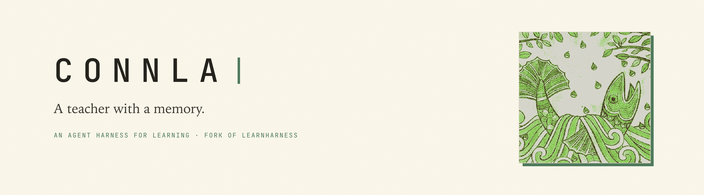
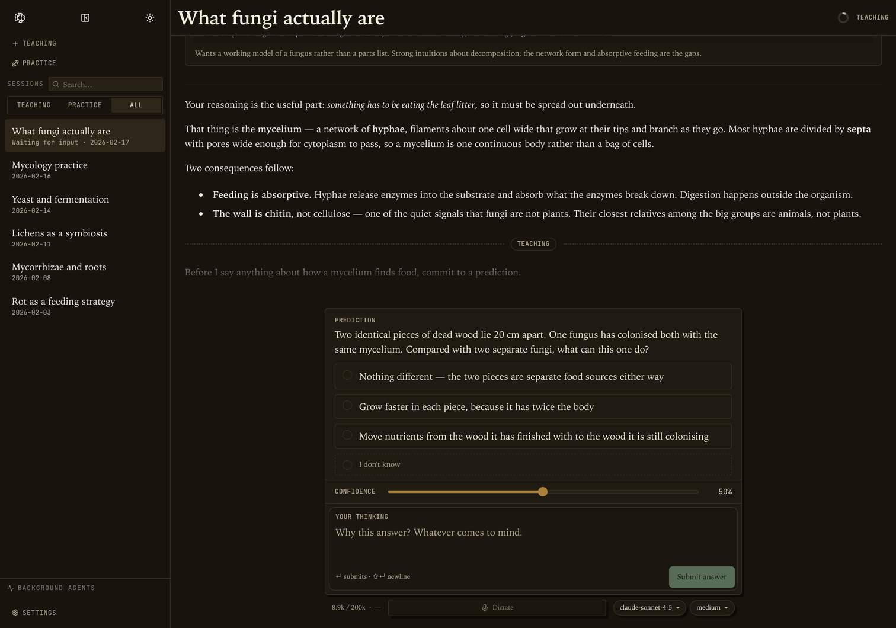
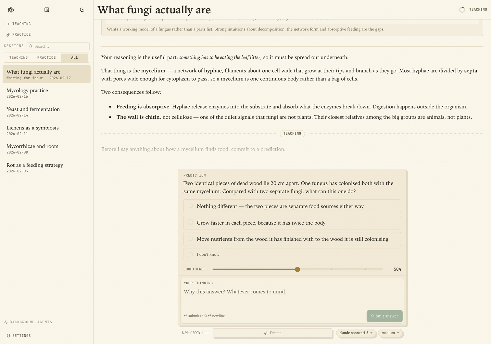
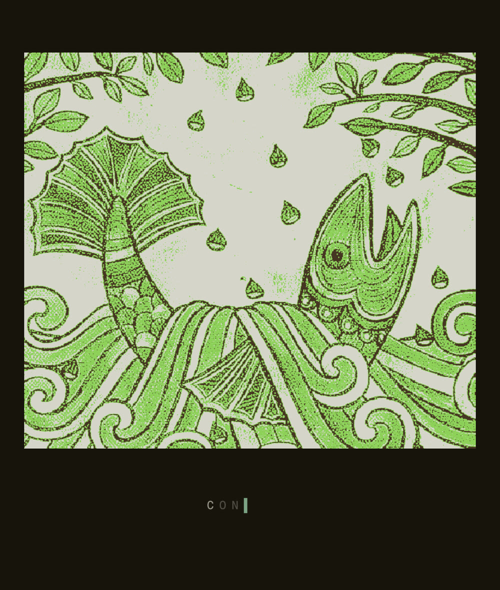

<p align="center"></p>

<p align="center"></p>

<p align="center">
  <a href="#how-it-works">How it works</a> ·
  <a href="#anki-export">Anki export</a> ·
  <a href="#what-this-fork-changes">What this fork changes</a> ·
  <a href="docs/README.md">Documentation</a> ·
  <a href="https://github.com/bittanaycha/Connla/issues">Issues</a>
</p>

**Connla** is a fork of [LearnHarness](https://github.com/amosblomqvist/learnharness), built on its teaching engine. LearnHarness plans lessons from your current understanding to your goal, teaches one reasoning step at a time, and keeps what you learn in a persistent knowledge graph. Connla keeps that engine and adds its own visual skin, selection tools, a saved library, and Anki export.

LearnHarness builds a detailed picture of what you understand and how you reason, and updates that picture as you learn. Instead of giving you an explanation, it uses your answers and thinking to decide what you need next. Teaching builds understanding one reasoning step at a time. Practice makes it usable. A persistent knowledge graph carries it across sessions.

## What this fork changes

Warm paper and sage ink in place of the dark default; a serif for what you read and a monospace for furniture; hard offset shadows where upstream had blur; one startup plate of the Salmon of Knowledge. The brand reads Connla everywhere a learner can see it.

Connla also adds:

- **Anki export.** Ask the teacher for a deck during a teaching session. It writes the deck, note type, fields, templates, CSS, cloze cards, tags, and media (including synthesized speech audio), then gives you a downloadable `.apkg` with a rendered preview.
- **Cards from selected text.** Select text in a lesson or question and choose **Create card**. A translation card puts the source text and its pronunciation audio on the front, with the translation on the back. An explanation card puts the selected text on the front, with a model-written explanation on the back.
- **Direct or queued delivery.** If AnkiConnect is running, choose a deck and send the card straight to Anki. Otherwise it goes to **Library → Cards**, where you can play its audio, send the queue, or export it as a deck.
- **A saved library.** Glossary entries, highlights, reading items, and queued cards are stored locally and stay linked to the session they came from.
- **Selection actions.** Translate, listen to pronunciation, add a glossary entry, save a highlight, or look up the selection on Wikipedia or Google without leaving the lesson.

The desktop bundle (`com.connla.Connla`) and update feed are Connla's own. The engine still tracks upstream LearnHarness.

<table>
  <tr>
    <td width="50%"></td>
    <td width="50%"></td>
  </tr>
  <tr>
    <td align="center"><sub>Teaching session, dark</sub></td>
    <td align="center"><sub>Teaching session, light</sub></td>
  </tr>
</table>

## The startup plate

<p align="center"></p>

The plate is a 1904 public-domain illustration of Connla's Well, dithered to ink with the `plate` tool from `unwalled-garden` (`--ink bone --screen stipple --cell 2 --grain 0.60`). Files live in `public/intro/`. On each launch the print loads as 10px squares in a top-down sweep, sharpens into the etching, holds while `CONNLA` types itself out, then coarsens back into pixels and clears.

## How it works

1. **Measure.** Before teaching, the agent finds where your understanding ends on each part the lesson depends on. Your answers, confidence, and thinking show it where to start.
2. **Plan.** It works out a dependency map from that starting point to your goal. You can see the plan, and the lesson adapts when your understanding turns out different.
3. **Teach.** Each step builds on something you already understand. You predict, get an explanation, and check your understanding. Confusions are repaired before anything is built on them. The aim is for the goal to feel obviously true, not merely familiar.
4. **Practice.** Separate sessions pose varied problems that require the right knowledge to come to mind without being named first. Problems and hints adapt to your reasoning.

**Think out loud.** The thinking fields let you explain your reasoning, uncertainties, and reactions in your own words. This is how the agent gets a detailed picture rather than just a record of right and wrong answers. You can type or use dictation.

**Bring your files.** In the desktop app, attach PDFs, photos, or any other file with the paperclip, or drag them in. The file stays where it is: the message carries its path, and the agent reads it from there.

The agent can also research questions in the background, create visual explanations, show your own images in the lesson and mark them up with arrows and labels, and build interactive demonstrations.

## Anki export

There are two ways to get material into Anki.

### Deck authored by the teacher

Ask in a teaching session, for example: “Make me an Anki deck on the causes of the French Revolution” or “Turn these five propositions into cloze cards.” The teacher can choose the deck name, note type, fields, card templates, CSS, tags, and cloze deletions. It can synthesize pronunciation audio with Azure Speech (or Edge TTS when Azure is not configured), or embed images and audio from local files the session can read. Speech is generated in the background, so the deck card shows progress and offers the download when the package is ready; a clip that still cannot be generated exports the card without that clip and records a warning.

The result is a standalone `.apkg` you can open in Anki, plus a preview that renders the cards with the deck's own CSS. This path does not need AnkiConnect or a running Anki.

### Quick cards from selected text

Select text in a lesson or question, then:

- **Create card → Translation.** The front is the selected text plus pronunciation audio; the back is the translation.
- **Create card → Explanation.** The front is the selected text; the back is a model-written explanation.

With the [AnkiConnect](https://ankiweb.net/shared/info/2055492159) add-on installed and Anki running, choose a deck and send the card directly. Without AnkiConnect, the card is saved to **Library → Cards**. From there you can play its audio, send the queue to a deck, or download the queue as an `.apkg`.

## Knowledge that carries forward

What you are taught accumulates as propositions and reasoning chains: individual claims and the premises that lead to them. The graph shows this structure, with links back to the source sessions. You can also import notes.

Future teaching sessions can read the graph instead of starting from scratch. Practice sessions can draw their material from it. It stores the ideas and their connections, not ratings of your ability.

## Download and get started

Connla builds are published on this fork's [GitHub Releases](https://github.com/bittanaycha/Connla/releases).

- **macOS (Apple Silicon):** download the DMG and drag the app to Applications. The macOS build is signed but not notarized; on first launch, macOS may ask you to confirm the app.
- **Windows and Linux:** the build configuration supports both, but the current release contains only the macOS build. Build from source with `npm run desktop:dist` on the target platform.

Upstream LearnHarness builds ship the upstream skin. To run Connla, use a Connla release or build this checkout.

Choose your models, then start a session with what you want to understand. You can use provider API keys, supported subscription connections in the desktop app, an installed [Claude Code CLI](docs/claude-code.md), or a [custom OpenAI-compatible endpoint](docs/custom-providers.md), including a local model server. Optional dictation, pronunciation audio, and web search use separate services. For reliable card audio, add an **Azure Speech** key and region in Settings → Providers → Keys; Azure uses the official neural voices, including Welsh, and falls back to Edge TTS when it is not configured. Web research can use a Tavily, Brave, Exa, Firecrawl, or Ollama key in Settings → Providers → Search. Ollama search uses its hosted service, not a local model server.

See [Getting started](docs/getting-started.md) for model setup, dictation, files, and notes imports, and [context, caching, and costs](docs/compaction-accounting.md) for advanced cache preferences.

## Your keys, your data

- **Your keys and models.** No subscription or markup. Billing depends on your provider, CLI configuration, subscription, or local setup. The live cost meter estimates known API costs, not subscription, CLI, or custom-endpoint charges.
- **Local storage.** Your chats, graph, library, cards, settings, and API keys live on your machine. Learning records are plain files you can inspect.
- **External services.** Models run through your configured providers. Model requests send the context needed for the task; web research, dictation, and pronunciation audio also contact external services (Azure or Edge for speech). AnkiConnect stays on your machine. Local storage does not mean offline processing.
- **Inspectable behavior.** System prompts are visible and editable. The app is open source under the AGPL-3.0 license.

## Development

```bash
npm ci
npm run dev        # http://localhost:3000
npm test           # fixtures and fake providers
npm run typecheck
npm run lint
```

The packaged app is built from the Next.js standalone output by `scripts/build-server.mjs`, then wrapped by `electron-builder`. `desktop:dist` also notarizes on macOS; on a machine without Xcode or a notary profile, pass `--config.mac.icon=build/icon.icns --config.mac.notarize=false` instead (the config's `build/icon.icon` needs `actool`).

Connla updates come from this repository's GitHub Releases. The app checks `latest-mac.yml` and the zip asset; publishing a release requires the DMG, the zip, both blockmaps, and `latest-mac.yml`.

See the [documentation index](docs/README.md) for all guides, [development](docs/development.md) for setup and checks, [architecture](docs/architecture.md) for the runtime, [keyboard shortcuts](docs/keyboard.md), and [desktop builds and releases](docs/desktop-release.md).

## License

[AGPL-3.0](LICENSE). Connla is made from [LearnHarness](https://github.com/amosblomqvist/learnharness), and its engine, agents, session machinery, knowledge graph, and desktop shell remain upstream work under the same licence.

The salmon plate is a public-domain 1904 illustration; the dither and the animation around it are part of this fork.
